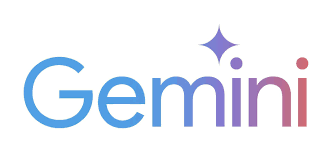

<p align="center">
  
</p>

<p align="center">
  <a href="https://github.com/ngucungcode/gemini-web-to-api/releases"></a>
  <a href="https://golang.org/"></a>
  <a href="https://www.docker.com/"></a>
  <a href="https://github.com/ngucungcode/gemini-web-to-api/blob/main/LICENSE"></a>
  
</p>

<p align="center">
  <a href="https://github.com/ngucungcode/gemini-web-to-api/stargazers"></a>
  <a href="https://github.com/ngucungcode/gemini-web-to-api/issues"></a>
  
</p>

<h1 align="center">Gemini Web To API 🚀</h1>

<p align="center">
  Transforms Google Gemini web interface into a standardized REST API.<br/>
  Multi-account cookie pool, automatic failover, web control dashboard, and drop-in OpenAI / Claude / Gemini compatibility.
</p>

<p align="center">
  <b>Created with ❤️ by <a href="https://github.com/ngucungcode">@ngucungcode</a></b>
</p>

> [!NOTE]
> This project is intended for **research and educational purposes only**. Please use responsibly and refrain from commercial use.

> [!WARNING]
> This project is not affiliated with Google. It uses reverse-engineered web cookies and may not comply with [Google's Terms of Service](https://policies.google.com/terms). Use at your own risk — the author assumes no responsibility for any account actions or data loss.

---

## 🌟 What's New in this Version

- 👥 **Multi-Account Round-Robin Pool**: Host $N$ Gemini accounts simultaneously. Requests rotate smoothly across healthy accounts with automatic failover.
- ⏱️ **Intelligent Cooldown & Health Management**: Quota-hit ($429$) accounts cool down for 5 minutes; auth errors pause for 10 minutes; network blips retry automatically.
- 🧩 **1-Click Cookie Extension**: Bundled Chrome extension in `extension/` reads cookies and auth slot from active Gemini tabs into ready-to-use `.txt` files.
- 🎛️ **Live Web Dashboard**: Real-time status UI at `/dashboard` (or `/`) showing account health, pool load, supported models, and dynamic account manager.
- 🔐 **Dynamic Admin API**: Add, rotate, or remove accounts at runtime via `/admin/accounts` with `ADMIN_TOKEN` security.
- 🛡️ **Engine Hardening**: Structured JSON mode enforcement, client cancellation deadline management, and auto-discovered Gemini models.

---

## 🎯 Key Features

- 🌉 **Universal AI Bridge**: One unified server, three standardized protocols:
  - **OpenAI**: `/openai/v1/chat/completions`, `/openai/v1/models`, `/openai/v1/images/generations`
  - **Anthropic Claude**: `/claude/v1/messages`
  - **Google Gemini**: `/gemini/v1beta/models/...:generateContent`
- 🔌 **Drop-in SDK Replacement**: Works seamlessly with official `openai`, `langchain`, `anthropic`, and `google-genai` libraries.
- 🔄 **Smart Session Management**: Automatically refreshes rotation tokens (`__Secure-1PSIDTS`) to keep sessions alive.
- ⚡ **High Performance**: Built with Go and Fiber v3 for low latency and high concurrency.
- 📝 **Interactive API Docs**: Interactive documentation powered by [Scalar](https://scalar.com) available at `/docs`.
- 🖼️ **Multimodal Capabilities**: Supports text-to-image generation and multi-image vision inputs (`data:`, remote URLs).

---

## ⚡ Quick Start

### 1. Get Your Cookies

The easiest way to extract cookies for 1 or more accounts is the bundled extension:

1. Open Chrome → go to `chrome://extensions` → toggle **Developer mode** on.
2. Click **Load unpacked** and select the `extension/` directory.
3. Open [gemini.google.com](https://gemini.google.com) signed into your Google account.
4. Click the extension icon → **Read cookies** → **Save .txt**.
5. Save the file into `cookies/` as `acc1.txt` (or `acc2.txt`, `acc3.txt` for extra accounts).

> [!TIP]
> **Auth Slot**: If your Gemini URL contains `/u/2/`, your auth slot is `2`. The extension detects this automatically, or you can create a companion `acc1.auth` file containing `2`.

---

### 2. Run the Server

#### Option A: Native Go (Recommended for local dev)

```bash
git clone https://github.com/ngucungcode/gemini-web-to-api.git
cd gemini-web-to-api

# Start server (automatically loads all cookies/*.txt)
go run cmd/server/main.go
```

#### Option B: Docker Compose

```bash
docker compose up -d --build
```

#### Option C: Docker Run

```bash
docker run -d -p 4981:4981 \
  -e GEMINI_COOKIES_DIR=cookies \
  -e ADMIN_TOKEN="your_secret_admin_token" \
  -v ./cookies:/home/appuser/cookies \
  --name gemini-web-to-api \
  --restart unless-stopped \
  ghcr.io/ngucungcode/gemini-web-to-api:latest
```

Server is ready at **`http://localhost:4981`** 🎉

---

## 🎛️ Control Dashboard & Health

- **Web Dashboard**: Open [`http://localhost:4981/dashboard`](http://localhost:4981/dashboard) in your browser.
  - Monitor pool health, active accounts, and cooldown timers.
  - Add or remove accounts dynamically without restarting.
- **Interactive API Docs**: Visit [`http://localhost:4981/docs`](http://localhost:4981/docs).
- **Health Check**:
  ```bash
  curl http://localhost:4981/health/accounts
  ```

---

## 🛠️ Configuration

Configure via environment variables or a `.env` file:

| Variable | Required | Default | Description |
| :--- | :---: | :---: | :--- |
| `GEMINI_COOKIES_DIR` | No | `cookies` | Directory containing `accN.txt` cookie files |
| `GEMINI_COOKIES` (+`_2`..`_10`) | No | — | Optional cookie header via env variable |
| `GEMINI_AUTH_USER` (+`_2`..`_10`) | No | — | Auth slot matching each env cookie (e.g. `2` for `/u/2/`) |
| `GEMINI_ACCOUNTS_JSON` | No | — | JSON array format for multi-account credentials |
| `ADMIN_TOKEN` | No | — | Secret token guarding `/admin/*` endpoints |
| `PORT` | No | `4981` | Server listen port |
| `GEMINI_REFRESH_INTERVAL` | No | `30` | Session token rotation interval (minutes) |
| `GEMINI_MAX_RETRIES` | No | `3` | Max retry attempts per request |
| `GEMINI_TEMPORARY` | No | `false` | Enable stateless incognito mode |
| `RATE_LIMIT_ENABLED` | No | `false` | Enable rate limiting |
| `RATE_LIMIT_MAX_REQUESTS` | No | `10` | Max requests per rate limit window |
| `RATE_LIMIT_WINDOW_MS` | No | `60000` | Rate limit window in ms |

---

## 🧪 Usage Examples

### 1. OpenAI SDK (Python)

```python
from openai import OpenAI

client = OpenAI(
    base_url="http://localhost:4981/openai/v1",
    api_key="not-needed"
)

response = client.chat.completions.create(
    model="gemini-2.5-flash",
    messages=[{"role": "user", "content": "Explain quantum computing in one sentence."}]
)
print(response.choices[0].message.content)
```

### 2. Anthropic Claude SDK (Python)

```python
from langchain_anthropic import ChatAnthropic

llm = ChatAnthropic(
    base_url="http://localhost:4981/claude",
    model="gemini-2.5-flash",
    api_key="not-needed"
)

response = llm.invoke("Write a haiku about code.")
print(response.content)
```

### 3. Google GenAI Native SDK (Python)

```python
from google import genai

client = genai.Client(
    api_key="not-needed",
    http_options={
        "base_url": "http://localhost:4981/gemini",
        "api_version": "v1beta",
    },
)

response = client.models.generate_content(
    model="gemini-2.5-flash",
    contents="Hello from Gemini SDK!",
)
print(response.text)
```

### 4. cURL

```bash
curl -X POST http://localhost:4981/openai/v1/chat/completions \
  -H "Content-Type: application/json" \
  -d '{
    "model": "gemini-2.5-flash",
    "messages": [{"role": "user", "content": "What is AI?"}]
  }'
```

---

## 🔐 Admin API Reference

All `/admin/*` endpoints require `Authorization: Bearer <ADMIN_TOKEN>` if `ADMIN_TOKEN` is configured:

| Method | Endpoint | Description |
| :--- | :--- | :--- |
| `GET` | `/admin/accounts` | List all configured accounts and health metrics |
| `POST` | `/admin/accounts` | Add or rotate an account dynamically (`{"name":"acc3","cookies":"...","auth_user":"2"}`) |
| `DELETE` | `/admin/accounts/:name` | Remove an account from the pool |

---

## 👤 Author

- **ngucungcode** ([@ngucungcode](https://github.com/ngucungcode))

---

## 📄 License

This project is licensed under the MIT License — see the [LICENSE](LICENSE) file for details.
